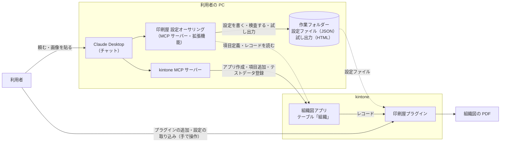

<!--
title: rex0220 印刷屋プラグイン - AI(Claude Desktop)に組織図を設計させてから、アプリを作らせる
tags:
  - kintone
  - Claude
  - MCP
private: false
url: https://qiita.com/rex0220/items/6e739ace80cffd2ad70a（2026-10-11 公開。Qiita に貼るときは、このコメントを除く）
-->

これまでの記事では、見積書・注文書・請求書のように、**アプリが先にあって、そのレコードを帳票にする**作り方をしました。今回は逆に、**帳票（組織図）を先に設計してから、それに合わせて kintone アプリを作り、テストデータで確かめる**順で進めます。

下は、できた組織図です。社長・部長・課長の箱と線、組織の TEL・メール・メンバーを、kintone アプリのテーブルから組み立てています。


この組織図は、**9 つの作成・修正の依頼と、AI からの確認への回答だけ**で作りました。設定の生成と検査、kintone へのアプリ作成などのツールの実行は、AI が会話の中で行っています。

| # | 頼んだこと | 結果 |
| :--- | :--- | :--- |
| 1 | `試作として、営業・開発・総務・経理の組織で社長から部長・課長までの組織図を作成` | 固定データの組織図（HTML と CSS だけ）ができた |
| 2 | （PDF の画像）※社長の文字が見えない | 画像だけを見て文字色を直した → **直らなかった** |
| 3 | `OK` | データ（配列）から組み立てる版ができた |
| 4 | `プレビューでは社長も表示されていたが、PDFでは見えない` | プレビューとの違いから原因をしぼり、`inline-block` をやめて → **直った** |
| 5 | `組織のTEL、メールと組織メンバーを追加して` | 連絡先とメンバーの欄が付いた |
| 6 | `kintone MCP で下記にアプリを作成して、テストデータを入力`（スペースの URL） | アプリとテストデータ 2 件ができた |
| 7 | `Go` | アプリのテーブルから組み立てる設定ができた |
| 8 | `テストデータに 2027-01-01 版で、商品企画部を追加して` | 3 件目のデータと、5 部でも収まる設定ができた |
| 9 | （PDF の画像）`はみ出た` | 古い設定の PDF だとわかり、新しい設定で解決 |

CSS や計算式は、今回も 1 行も書いていません。

かかった時間は、**試作を頼んでから、5 部の組織図が PDF で出るまで約 40 分**でした。PDF を見て確かめる時間も含みます。

| 区切り | 時刻 | かかった時間 |
| :--- | :--- | :--- |
| 試作（固定データ → データから組み立て → 連絡先とメンバー） | 18:16〜18:33 | 約 17 分 |
| アプリの作成 → テーブルにつなぐ → 3 件目の版で確かめる | 18:43〜18:54 | 約 11 分 |
| 合計（あいだの確認を含む） | 18:16〜18:54 | 約 40 分 |

時刻は、頼んだ時刻と、kintone のアプリとレコードの作成日時・更新日時から取りました。

> 拡張機能（印刷屋 設定オーサリング）の入れ方と、帳票を最初に作る手順は [最初の記事](https://qiita.com/rex0220/items/8cbebab5a5f8a9c21b1f) を見てください。アプリを作る手順では、kintone MCP サーバーも使います。

---

# なぜ帳票を先に設計するのか

組織図は、見積書と違って、**データの件数で形が変わる図**です。部が 4 つか 5 つか、課が 2 つか 3 つかで、線の引き方も箱の幅も変わります。

始める前に、AI と次のことを確かめました。

- 印刷屋の帳票の HTML は、安全のため、使える要素と属性が決まっていて、**インラインの `<svg>` が使えない**。社印のような固定の図は `` で入れられるが、データで中身が変わる図は、計算式の結果を `src` 属性に入れることになる。レコードの値で属性が壊れたり、意図しない内容が入ったりしないよう、「属性にレコードの値を入れない」決まりがあるので、この方法は取れない
- そのため、**線は CSS の `border` と `::before` / `::after` で引く**。ただし、印刷屋は html2canvas でページを画像にしてから PDF にするので、疑似要素の線が PDF に出るかは、試すまでわからない

先にアプリを作り込んでから「線が PDF に出ない」とわかると、手戻りが大きくなります。そこで、**アプリを作らずに、既存のアプリ（見積書アプリ 3740）のボタンとして固定データの組織図を作り、見た目と PDF への出方を先に確かめる**ことにしました。

## 仕組みの構成

今回使う仕組みと、そのつながりです。Claude Desktop から 2 つの MCP サーバーを使い分けます。



印刷屋 設定オーサリングは kintone に書き込みません。kintone を変えるのは kintone MCP サーバー（アプリとデータ）と、利用者の手作業（プラグインと設定の取り込み）だけです。

---

# 1. 固定データで見た目を決める

最初の頼み方はこれだけです。

```
試作として、営業・開発・総務・経理の組織で社長から部長・課長までの組織図を作成
```

AI は、データをどこに置くかだけを選択肢で聞いてきました。

| 選択肢 | 内容 |
| :--- | :--- |
| 固定データで見た目を先に確認（推奨） | 架空の氏名を HTML に直接書き、既存のアプリのボタンとして作る |
| 組織図アプリを新しく作る | 版ごとに 1 レコード、テーブルに部署の一覧を持つ |
| cybozu の組織情報（OINFO） | kintone の組織の設定から直接作る |

「固定データ」を選ぶと、AI は次の形で作りました。

- A4 横。社長の下に 4 部長を横に並べ、各部の課長は部の下に縦に並べる（課が 10 あるので、横一列では A4 横に収まらない）
- 線は CSS だけで引く。横線は各部の列の上辺（左端の部は右半分、右端の部は左半分だけ）、縦線は `::after`、課への枝は `::before` の L 字
- 計算式は使わず、HTML テンプレートだけ

線を引く CSS の中心は、次の部分です。

```css
.oc-dept::before {          /* 部の列の上辺の横線 */
  content: "";
  position: absolute;
  top: 0; left: 0; right: 0;
  border-top: 2px solid #555;
}
.oc-dept:first-child::before { left: 50%; }
.oc-dept:last-child::before  { right: 50%; }
.oc-sec::before {           /* 課への L 字の枝 */
  content: "";
  position: absolute;
  left: 14px; top: -10px; bottom: 50%;
  width: 16px;
  border-left: 2px solid #555;
  border-bottom: 2px solid #555;
}
```

印刷屋で PDF にすると、**横線・縦線・L 字の枝は、すべて PDF に出ました**。課の数が部によって違っても（3 課と 2 課）、縦線の長さは自動で合います。疑似要素で線を引く方式は、そのまま使えることがわかりました。

---

# 2. PDF でだけ文字が消える — inline-block

ところが、社長の箱（濃紺の背景に白い文字）だけ、**PDF で文字が見えません**でした。


PDF の画像を貼ると、AI は最初、文字色の指定が共通 CSS に負けていると見て、色の指定を文字の要素に移しました。しかし、直りませんでした。

次に、こう伝えました。

```
プレビューでは社長も表示されていたが、PDFでは見えない
```

ブラウザーのプレビューでは見えて、PDF でだけ消えるので、AI は原因を html2canvas の描画にしぼりました。社長の箱と部長の箱（こちらは文字が出る）の CSS を比べ、**社長の箱だけが `display: inline-block` だった**ことに目を付け、html2canvas での描画との相性を疑っています。

部長の箱と同じく、`display: block` と `margin: 0 auto` で中央に置く形に変えると、社長の文字が PDF に出ました。html2canvas の中で何が起きていたか（背景と文字の描画の順など）までは確かめていません。言えるのは、**今回の環境では、この変更で直った**ということです。

```css
/* 直す前 */
.oc-lv0 {
  display: inline-block;
  width: 240px;
  background: #1f3a5f;
}

/* 直した後: display の指定を消した（要素は div なので block になる） */
.oc-lv0 {
  width: 260px;
  margin: 0 auto;
  background: #1f3a5f;
}
```

幅が 240px から 260px に変わっているのは、4 章で連絡先を足したときに広げたためです。

最初の推測が外れても、「プレビューでは出る、PDF では出ない」という**違いを伝えると、原因の範囲がしぼられます**。

---

# 3. データから組み立てる

見た目が決まったので、次は同じ見た目のまま、**データから組み立てる**形にします。アプリはまだ作らず、データは計算式の中の配列に置きました。

```
OK
```

AI は、部署 1 つを `code`（組織コード）/ `parent`（親の組織コード）/ `name` / `person` の辞書にし、その配列から社長・部・課を組み立てました。計算式の骨組みは次のとおりです。

```
LET(root, ARRAY_GET(ARRAY_FIL(orgs, vR, DIC_ITEM(vR, "parent") = ""), 0),  // 親が空 = 社長
TAGS_HTML(
  TAG("div", ATTR("class", "oc-depts"),
    ARRAY_MAP(ARRAY_FIL(orgs, vP, DIC_ITEM(vP, "parent") = DIC_ITEM(root, "code")), vD,   // 部
      TAG("div", ATTR("class", "oc-dept"),
        …部の箱…,
        ARRAY_MAP(ARRAY_FIL(orgs, vQ, DIC_ITEM(vQ, "parent") = DIC_ITEM(vD, "code")), vS, // 課
          …課の箱…
        )
      )
    )
  )
))
```

ポイントは、**課を絞り込む内側の `ARRAY_FIL` から、外側の変数 `vD`（今の部）を参照している**ところです。これが通るかどうかが、データから組み立てられるかの分かれ目でした。印刷屋の PDF で、課が正しく各部の下に並ぶことを確かめています。

`ATTR` に入れているのは、`oc-dept` のような**固定の class 名だけ**です。検査では `formula.rawHtml`（`TAG` などの結果がそのまま HTML になる）の警告が 1 件出ますが、AI は消さずに伝え、class 名が固定であることを理由に残しました。

---

# 4. 連絡先とメンバーを足す

```
組織のTEL、メールと組織メンバーを追加して
```

AI はデータに `tel` / `mail` / `members`（氏名の配列）を足し、箱の中を「組織名 → 長 → TEL → メール → 点線 → メンバー」の順にしました。

- メンバーは flexbox の折り返しで横に並べ、箱の幅で自動で改行する
- メンバーがいない組織（各部）は、`IF(ARRAY_COUNT(…) > 0, …, "")` で欄ごと出さない
- 情報が増えた分、線の間隔や文字の大きさを少し詰め、いちばん縦に長い開発部（3 課、4 名の課あり）でも A4 横に収まるように計算した


ここまでで、**帳票の形（どんな項目が要るか）が決まりました**。これが、次に作るアプリの設計になります。

---

# 5. kintone MCP でアプリを作る

帳票で使った項目を、そのまま kintone アプリにします。

ここから kintone MCP サーバーも使うので、どの仕組みが何をするかを整理しておきます。

| 操作 | 使う仕組み |
| :--- | :--- |
| 組織図の HTML・CSS・計算式を書く、印刷屋の設定ファイルを作る・検査する・試し出力する | 印刷屋 設定オーサリング（拡張機能） |
| kintone アプリを作る、項目を足す、テストデータを入れる | kintone MCP サーバー |
| アプリに印刷屋プラグインを追加する、設定ファイルを取り込む | 手で操作 |
| PDF を出して確かめる | 印刷屋プラグイン |

```
kintone MCP で下記にアプリを作成して、テストデータを入力
https://（サブドメイン）.cybozu.com/k/#/space/327/thread/370
```

AI はスペースの情報を取り、既定のスレッドが 370 であることを確かめてから、アプリ「組織図(印刷屋)」を作りました。

| 項目 | 型 | 帳票での使い道 |
| :--- | :--- | :--- |
| 基準日 | 日付（必須） | 見出しの「〇年〇月〇日現在」、ファイル名 |
| 会社名・作成部署 | 文字列（1行） | フッター |
| 組織（テーブル） | テーブル | 1 行 = 1 組織 |
| 　組織コード | 文字列（1行・必須） | `code` |
| 　親組織コード | 文字列（1行） | `parent`。最上位は空 |
| 　組織名・役職・氏名 | 文字列（1行） | `name`、`person`（役職と氏名を組み立てる） |
| 　TEL・メール | リンク（電話・メール） | `tel`、`mail` |
| 　メンバー | 文字列（複数行） | `members`。1 行 1 名 |

**1 レコード = 1 つの版（〇年〇月〇日現在の組織図）** にしたので、異動のたびにレコードを足していけば、過去の組織図も残ります。

テストデータは 2 件です。

- **2026年10月1日現在**: 試作と同じ 15 組織
- **2026年4月1日現在**（異動前）: 開発二課がなく、総務課と人事課が「総務人事課」1 つ

2 件目は、組織の数や親子関係が変わっても図が組み立て直されるかを確かめるためのデータです。氏名・電話番号・メールは、すべて架空です（番号は `03-0000-xxxx`、ドメインは例示用の `example.jp`）。


（画像は、7 章で足した 2027年1月1日現在のレコードです）


> アプリへの印刷屋プラグインの追加は、kintone MCP ではできないので、手で追加します。

---

# 6. テーブルから読む

アプリに印刷屋プラグインを追加してから、こう頼みました。

```
Go
```

AI は、アプリの項目定義とレコード 2 件（形だけ）を取り込み、計算式の**データの部分だけ**をテーブルから読む形に差し替えました。組み立ての部分（3 章の骨組み）はそのままです。

```
DIC_MAP(
  TABLE_DIC(組織, "k" & 組織コード, TPDIC(
    "code", 組織コード,
    "parent", 親組織コード,
    "name", ESC_HTML(組織名),
    "person", ESC_HTML(IF(役職 = "", 氏名, 役職 & "　" & 氏名)),
    "tel", ESC_HTML(TEL),
    "mail", ESC_HTML(メール),
    "members", メンバー
  )),
  vK, vV, vV)
```

ここには、AI が入れた工夫が 3 つあります。

- **キーに `"k"` を付ける**: `TABLE_DIC` は辞書（JavaScript のオブジェクト）を作ります。JavaScript では、`"100"` のような数字だけのキーは整数のインデックスとして扱われ、列挙の順が入れた順でなく数値の順になります。そこで組織コードに `"k"` を付けて、ふつうの文字列のキーにしています。7 章のデータ（商品企画部 150 を開発部 120 と総務部 130 の行のあいだに置いたもの）で、**テーブルの行の順と表示の順が一致する**ことを確かめました。組織コードは重複しないことが前提です（重複すると、資料の仕様では最初の行だけが残ります）
- **`TAG` に入れる前に `ESC_HTML` を通す**: 拡張機能の資料（帳票関数リファレンス）では、`TAG` は文字列の子の `<` `>` だけをエスケープし、`&` と引用符はそのまま入れます。レコードの値が入るようになったので、組織名・役職と氏名・TEL・メールは、辞書に入れる時点で `ESC_HTML` を通しています
- **メンバーは分けてからエスケープする**: メンバーは 1 行 1 名の複数行の文字列なので、辞書にはそのまま入れ、箱を組み立てるところで `SPLIT(…, NEWLINE(), 1)` で 1 名ずつに分け（空行は除く）、**1 名ずつ `ESC_HTML` を通して** `<span>` に入れます

```
ARRAY_MAP(SPLIT(DIC_ITEM(vS, "members"), NEWLINE(), 1), vM2,
  TAG("span", ATTR("class", "oc-mem"), ESC_HTML(vM2)))
```

見出しの日付、フッターの会社名、ファイル名（`組織図-20261001.pdf`）も、レコードの値から作ります。試し出力は、2 件とも 1 ページ、式のエラー 0 でした。

---

# 7. 版を足して確かめる

最後に、組織が大きく変わる版を足して、帳票が耐えられるかを確かめました。

```
テストデータに　2027-01-01 版で、商品企画部を追加して
```

AI は 1 件目をもとに、次のように変えた 3 件目を作りました。

- 商品企画部と、その下の商品企画課を新設
- 営業企画課を、営業部から商品企画部へ移す（親組織コードを変えるだけ）
- テーブルでは、商品企画部を開発部の後の行に置く（表示順が行の順になるかの確認）

あわせて AI は、**部が 5 つになると今の CSS では収まらない**ことを、頼まれる前に指摘しました。A4 横の本文の幅は約 1023px なので、5 列だと 1 列約 205px になり、幅 220px 固定の箱がはみ出します。箱の幅を「最大 220px、列が狭ければ縮む」に変えた設定を、新しいファイルで作り直しています。

```css
.oc-dept { flex: 1 1 0; min-width: 0; padding: 20px 6px 0; }
.oc-lv1, .oc-secs { max-width: 220px; margin: 0 auto; }
```

## 「はみ出た」の正体

ところが、印刷屋の PDF は右にはみ出していました。


```
はみ出た
```

AI は画像の箱の幅と並び方を見て、**これは新しい設定ではなく、前の設定で描画されている**と答えました。箱がちょうど 220px で隙間なく並んでいるのは前の CSS の特徴で、新しい CSS なら箱と箱の間に隙間ができるはずだ、という理由です。

確かめると、そのとおりでした。新しい設定を「一部置換」で取り込み直すと、5 部が重ならずに並びました（冒頭の画像）。営業企画課の移動、商品企画部の並び順も、データどおりです。

---

# 設計してから作るコツ

## 帳票で試してから、項目を決める

固定データの帳票で、載せる項目と見た目を先に決めると、アプリの項目がそのまま決まります。今回は、帳票のデータの辞書（`code` / `parent` / `name` / …）が、アプリのテーブルの列になりました。

## 危ないところから先に試す

今回いちばん不確かだったのは「CSS の線が PDF に出るか」でした。アプリより先にそこを確かめたので、後の作業で手戻りがありませんでした。

## 「プレビューと PDF の違い」を伝える

プレビュー（ブラウザーの描画）と印刷屋の PDF（html2canvas の描画）は、同じ HTML でも結果が違うことがあります。違いを伝えると、AI が原因をしぼれます。

## テストデータに「変化」を入れる

同じ形のデータばかりでは、帳票の弱いところが見えません。組織の新設・統合・移動、部の数の増減のように、**形が変わるデータ**を版として足すと、帳票の限界がわかります。

---

# 気を付ける点

- **階層は 3 段（最上位・部・課）まで**: 4 段目（係など）があってもエラーにはならず、表示されないだけです。必要なら、課の箱の中に係を並べるように頼みます
- **部が 6 つ以上**: 箱が細くなりすぎて読みにくくなります。A3 横にするか、部ごとにページを分けるように頼みます
- **`formula.rawHtml` の警告**: 今回は `TAG` で HTML を組み立てているため、この警告が出ています。`ATTR` に固定の class 名だけを入れていること、レコードの値は `ESC_HTML` を通していることを、差分で確かめてください
- **取り込むファイルを取り違えない**: 作り直した設定は、別の名前のファイルになります。古いファイルを取り込むと、直したはずの問題がそのまま出ます
- **プレビューは近似**: 書体や細部は、印刷屋の PDF で確かめます

次の点は、今回のテストデータでは**確かめていません**。計算式の作りから、こうなると考えられます。

| 場合 | 考えられる結果 |
| :--- | :--- |
| 組織コードが重複している | 辞書にするときに、後の行が捨てられる |
| 親組織コードに、ない組織を書いた | その組織（と、その下の組織）は表示されない |
| 1 つの課のメンバーが多い | 部の数が少なくても、縦にはみ出してページの下で切れる |

はみ出したときは、`メンバーは人数だけ表示して`、`メンバーの文字を小さくして`、`A3 横にして` のように頼むと、収め方を変えられます。

---

# まとめ

- **帳票を固定データで先に設計し、PDF への出方まで確かめてから、それに合わせてアプリを作る**と、手戻りが少ない
- 組織図の線は、CSS の `::before` / `::after` で引け、PDF にも出る。PDF でだけ文字が消えたときは、プレビューとの違いを伝えて原因をしぼる（今回は `inline-block` をやめて直った）
- 親子関係のテーブル（組織コード / 親組織コード）から、`ARRAY_FIL` と `ARRAY_MAP` の入れ子で図を組み立てられる。テストデータの版を足すだけで、組織の変更が図に反映される

シリーズ「rex0220 印刷屋プラグイン - AI(Claude Desktop)に〜」:

1. [チャットで帳票を作らせる](https://qiita.com/rex0220/items/8cbebab5a5f8a9c21b1f)
2. [帳票のデザインを作り込ませる](https://qiita.com/rex0220/items/43ceafa584690b4b0a5b)
3. [見積書から注文書・請求書を作らせる](https://qiita.com/rex0220/items/eae546dc726e7c61512f)
4. **組織図を設計させてから、アプリを作らせる（この記事）**
5. [QRコード付きの資産ラベルを作らせる](https://qiita.com/rex0220/items/a649d70314361b964cd2)
6. [写真付きの点検報告書を作らせる](https://qiita.com/rex0220/items/b10502d8d23373820aab)

関連リンク:

- [拡張機能（GitHub）](https://github.com/rex0220/print-craft-authoring-mcp)
- [拡張機能の最新のリリース](https://github.com/rex0220/print-craft-authoring-mcp/releases/latest)
- [製品紹介記事](https://qiita.com/rex0220/items/9be2d9b20a3a1f016c76)
- [FAQ](https://qiita.com/rex0220/items/a866440c50c1028acb4f)
